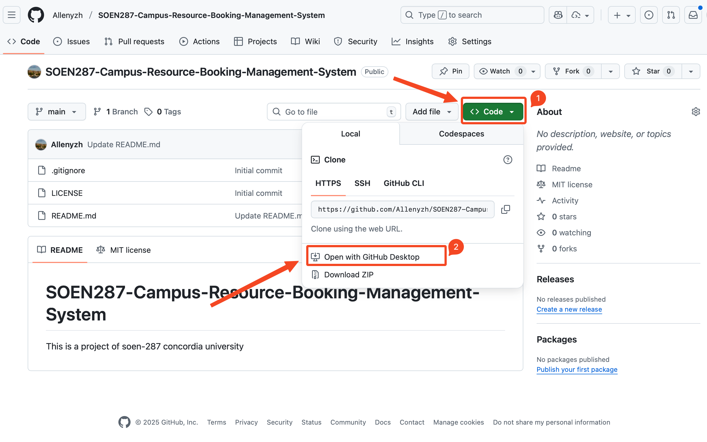

# SOEN287 Campus Resource Booking Management System

[中文]()

---

## Code Collaboration

- Create a new branch for each contribution and open a Pull Request. This lets everyone see what changed and helps resolve merge conflicts efficiently.

---

## Features

- Real-time booking cards: show resource availability and emphasize an instant booking experience.
- Responsive navigation: horizontal nav on desktop + drawer menu on mobile, all powered by a single data source for easy maintenance.
- Informational components: components like `DisplayCard`, `Features`, and `Resource` are data-driven and reusable.
- Modern UI: built with Tailwind CSS + shadcn/ui.

---

## Tech Stack

- [Next.js 15](https://nextjs.org/) (App Router)
- [React 19](https://react.dev/)
- [TypeScript](https://www.typescriptlang.org/)
- [Tailwind CSS 4](https://tailwindcss.com/)
- [shadcn/ui](https://ui.shadcn.com/) component library
- [pnpm](https://pnpm.io/) as the recommended package manager

---

## Environment Setup

1. Install Node.js (LTS version ≥ 20 recommended)

   - Download and install from [nodejs.org](https://nodejs.org/).
   - After installation, verify in your terminal (Terminal on macOS, PowerShell on Windows):

     ```bash
     node -v
     npm -v
     ```

     If versions are printed, the installation is successful.

2. Install pnpm (recommended)

   - In your terminal, run:

     ```bash
     npm install -g pnpm
     ```

   - Verify:

     ```bash
     pnpm -v
     ```

   - You can use npm/yarn if you prefer, but this documentation uses pnpm by default.
     > ps: pnpm generally saves disk space compared to npm.

3. Prepare a Git client (optional)

   - We recommend [GitHub Desktop](https://desktop.github.com/download/).

---

## Run Locally

The following commands are shown for macOS `zsh`. Windows users can run the same commands in PowerShell.

1. Clone the repository (or unzip the ZIP)

   - If you installed GitHub Desktop, click:
     

2. Install dependencies

   ```bash
   pnpm install
   ```

3. Start the dev server

   ```bash
   pnpm dev
   ```

4. Open the app

   - Default URL: <http://localhost:3000>

5. Stop the dev server

   - Press `Ctrl + C` in the terminal where it’s running.

---

## Project Structure Overview

```text
SOEN287-Campus-Resource-Booking-Management-System
├── public/                     # Static assets
│   └── *.svg
├── src/
│   ├── app/                    # Next.js App Router entry
│   │   ├── page.tsx            # Home page
│   │   ├── layout.tsx          # Global layout
│   │   └── globals.css         # Global styles
│   ├── components/
│   │   ├── home/
│   │   │   ├── DisplayCard.tsx # Generic card component
│   │   │   ├── Features.tsx    # Feature section
│   │   │   ├── Resource.tsx    # Resource list
│   │   │   ├── SideDrawer.tsx  # Mobile drawer navigation
│   │   │   └── nav.tsx         # Top navigation
│   │   └── ui/                 # shadcn/ui wrappers
│   └── lib/
│       └── utils.ts            # Utility functions
├── next.config.ts              # Next.js config
├── package.json                # Project metadata & scripts
└── tsconfig.json               # TypeScript config
```

---

## Troubleshooting

| Issue                                            | Solution                                                                                                                                                          |
|--------------------------------------------------|-------------------------------------------------------------------------------------------------------------------------------------------------------------------|
| `pnpm` command not found                         | Run `npm install -g pnpm` to install pnpm globally.                                                                                                               |
| CORS error when accessing via LAN address        | Open `next.config.ts`, add the corresponding `http://IP:PORT` to `allowedDevOrigins`, then restart with `pnpm dev`.                                               |
| Port 3000 is in use                              | Start on a different port: `pnpm dev -- --port 3001`, then open `http://localhost:3001`.                                                                          |
| TypeScript errors or missing syntax highlighting | Ensure VS Code has the built-in "TypeScript + JavaScript Language Features" enabled and that you’re using the workspace TypeScript (indicated in the status bar). |

---

## Contributing

Contributions are welcome! Please create a branch for your change, open a Pull Request, and follow the steps in this README to set up and run the project locally.

---

## Documentation & Resources

- [Next.js Docs](https://nextjs.org/docs)
- [React Docs](https://react.dev/learn)
- [Tailwind CSS Docs](https://tailwindcss.com/docs)
- [shadcn/ui Docs](https://ui.shadcn.com/docs)
